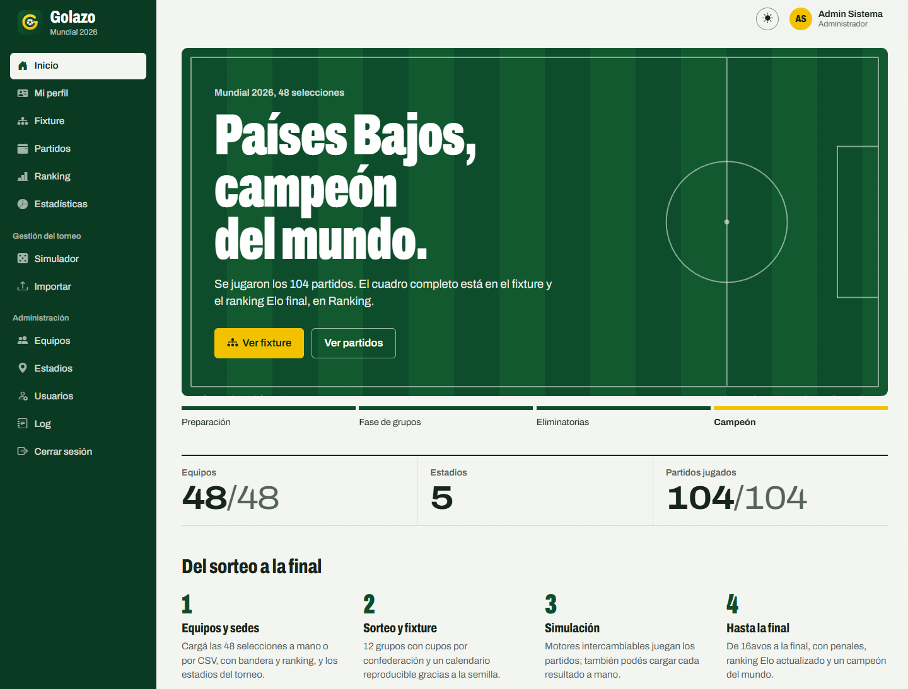
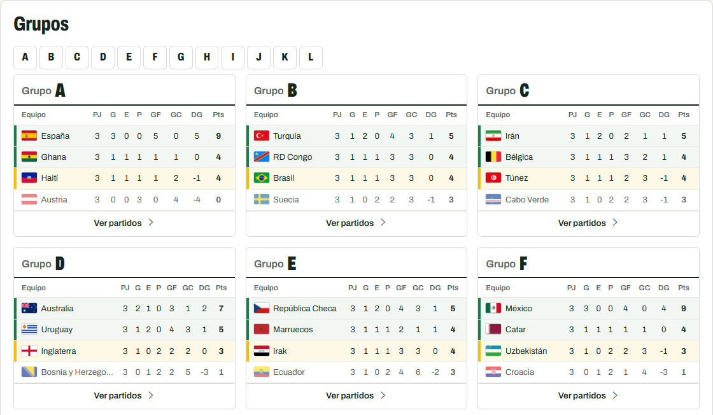
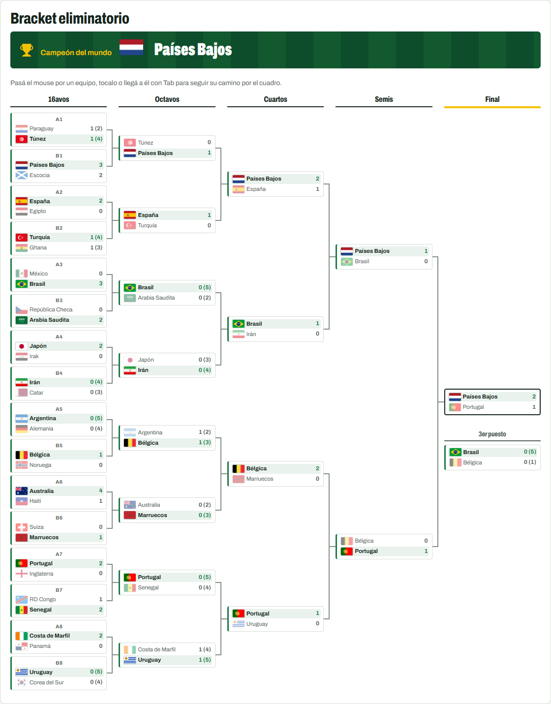

# Golazo

[](https://github.com/manuelgcn/worldcup-planner/actions/workflows/dotnet-tests.yml)

Golazo plans and runs a 48-team World Cup: team and stadium management, the group draw,
the group-stage fixture, the knockout bracket from the round of 32 to the final, an Elo
ranking and match simulation. It is a Blazor Server application on .NET 8 with EF Core.

The codebase, solution and namespaces are named `WorldCupPlanner`; Golazo is the name of the UI.

University project for *Diseño de Aplicaciones 1*, Universidad ORT Uruguay (2026).



## Highlights

- **1,258 automated tests and about 97% line coverage** (migrations, Razor components and
  `Program.cs` excluded), as of November 2026: 408 on the domain, 606 on the services, 164 on
  data access and 80 on the UI's helper classes. They run in CI and need no database.
- **Written with TDD.** The history has one commit per RED, GREEN and REFACTOR step.
- **Layered architecture.** The UI only presents, the services hold the use cases, and the
  domain depends on nothing.
- **Deterministic draws and simulations.** Every shuffle takes a seed, so a tournament can be
  reproduced exactly, and each seeded operation is written to the audit log.
- **Audited after delivery.** Backend, security, accessibility and UX reviews were run on the
  finished project; what is still pending is listed in [TODO.md](TODO.md).

## Features

- Teams with confederation, FIFA ranking and flag, entered by hand or imported from a UTF-8 CSV
  with a header row (a 48-team sample is in `samples/`).
- Stadiums, and a group draw into 12 groups of 4 that respects confederation quotas.
- Group-stage fixture with dates, kick-off times and stadium rotation.
- Standings per group and the full knockout bracket, including penalties and the third-place match.
- Two interchangeable simulation engines (probabilistic and pure random); results can also be entered by hand.
- Elo ranking recalculated after every result, and an Elo-based forecast (home win, draw, away win)
  next to each match that has not been played.
- Tournament statistics (`/stats`) and a profile page per team (`/team/{id}`) with its record,
  its matches and how far it got.
- Roles: Admin, Editor and Journalist. Journalists are notified of match results.
- Users change their own password from their profile ("Mi perfil").
- CSV and XLSX export of the fixture and of the audit log, which records every change with its
  author and time; the fixture also exports as an iCalendar (`.ics`) file.
- Day and night themes, with a toggle that remembers the choice.





## Tournament rules

- **Quotas:** UEFA 16, CAF 9, AFC 8, CONMEBOL 7, CONCACAF 7, OFC 1. A group holds at most two
  UEFA teams and at most one team from any other confederation.
- **Group fixture:** six matches per group over three matchdays (1–4 and 2–3, then 1–3 and 2–4,
  then 1–2 and 3–4). The last matchday of a group is played at the same day and time.
- **Standings:** points, then goal difference, then goals scored, then a seeded draw.
- **Round of 32:** the 12 group winners, the 12 runners-up and the 8 best third-placed teams,
  avoiding same-group pairings when possible.
- **Determinism:** every shuffle is a Fisher–Yates with a configurable seed, so the same seeds
  always produce the same tournament. Each seeded operation is written to the audit log.
- **Editing:** only the date, stadium and result of a match can change. Group matches lock once
  the knockout stage exists; a knockout match locks once the next round is built from it, and
  it cannot end in a draw.

## Security

- Passwords are stored as salted PBKDF2-SHA256 hashes that carry their version and iteration
  count (600,000 today); an older hash is replaced on its owner's next login. Five failed
  logins within five minutes lock an email for five minutes.
- A session survives reloads within a browser tab for up to eight hours. Logging out revokes it,
  in duplicated tabs too, changing the password ends the account's other sessions, and the
  user's roles are read again from the database before every action that changes or exports data.
- Every response carries security headers and a Content-Security-Policy that only lets scripts
  load from the app itself (`src/WorldCupPlanner.UI/SecurityHeaders.cs`).
- The CSV import refuses a file that is not valid UTF-8 or has no header row, and a flag upload
  must be a PNG, JPEG, WebP or SVG image by content.
- Audit rows keep the actor's email and user id.

To report a vulnerability see [SECURITY.md](SECURITY.md). Known weaknesses are listed in [TODO.md](TODO.md).

## Getting started

Requirements: [.NET 8 SDK](https://dotnet.microsoft.com/download) and [Docker](https://www.docker.com/).

```bash
cp .env.example .env
docker compose up -d sqlserver
dotnet run --project src/WorldCupPlanner.UI
```

The database is Azure SQL Edge, which also runs on ARM64. Its port is published on
`127.0.0.1` only. On startup the app applies pending migrations and creates the tournament
settings and, unless `Demo:Enabled` is `false`, the three demo users if they are missing. Open
the URL printed in the console.

To load a demo tournament (48 teams with flags, 5 stadiums, 6 extra users and a simulated
group stage), run the seeder. It resets the database first.

```bash
dotnet run --project src/WorldCupPlanner.DataSeeder
```

### Docker

The app can also run in a container next to the database:

```bash
docker compose --profile app up
```

The image is built from the root `Dockerfile`, runs as a non-root user and is published on
`http://127.0.0.1:8080`; without the profile, Compose still starts only the database.
`GET /health` answers `200 Healthy` when the database can be reached and `503 Unhealthy` when
it cannot, with no other detail; the container's health check uses it.

### Accounts

| Role | Email | Password | Created by |
|---|---|---|---|
| Admin | admin@copa.com | Admin@123 | App startup |
| Editor | editor@copa.com | Editor@123 | App startup |
| Journalist | periodista@copa.com | Periodista@123 | App startup |
| Admin | admin1@copa.com | Admin@123 | Demo seeder |
| Editor | editor1@copa.com | Editor@123 | Demo seeder |
| Journalist | periodista1@copa.com | Prensa@123 | Demo seeder |

The startup accounts are only created while `Demo:Enabled` is `true`. A password above only
holds until its owner changes it from "Mi perfil"; the system admin (user id 1) cannot.

### Configuration

Settings live in `src/WorldCupPlanner.UI/appsettings.json`:

- `ConnectionStrings:Default`: the database. It can be overridden with the
  `ConnectionStrings__Default` environment variable. Use `127.0.0.1`, not `localhost`: on
  Windows `localhost` resolves to `::1`, which Docker does not forward to SQL Edge.
- `TournamentSettings`: start date, maximum matches per day, days between matchdays and the
  four seeds (`FixtureSeed`, `CrossingsSeed`, `SimulationSeed`, `CompletionSeed`). They are
  only read when the database has no settings yet. `MaxMatchesPerDay` (1 to 3) counts kick-off
  slots per stadium and day in the group stage and matches per day in the knockout stage.
  `DaysBetweenJourneys` is the minimum gap between a group's matchdays, which are spaced
  further apart when one does not fit in it, and the gap between knockout rounds; the final
  is played the day after the third-place match.
- `Demo:Enabled` (default `true`): creates the three demo accounts at startup and shows their
  credentials on `/login`. With `false` neither happens, existing accounts are left as they
  are, and the app refuses to start unless some user has the Admin role.
- `Flags:Directory`: the folder with the flag images, relative to the UI project.

## Tests

```bash
dotnet test
```

The suites need no database: unit tests use the EF Core InMemory provider, and tests that
need real foreign keys use SQLite in memory. One suite per layer:

```bash
dotnet test tests/WorldCupPlanner.Domain.Tests
dotnet test tests/WorldCupPlanner.Services.Tests
dotnet test tests/WorldCupPlanner.DataAccess.Tests
dotnet test tests/WorldCupPlanner.UI.Tests
```

CI runs build, tests and a coverage report on every push and pull request to `main` and `develop`.
CodeQL analyses the C# code on the same events and once a week, and Dependabot proposes NuGet,
GitHub Actions and Docker updates weekly.

## Architecture

```
UI ──▶ Services ──▶ Domain
          │
          ▼
      DataAccess ──▶ Domain
```

| Project | Responsibility |
|---|---|
| `WorldCupPlanner.Domain` | Entities, enums, invariants and domain exceptions. No dependencies. |
| `WorldCupPlanner.Services` | Use cases, orchestration, DTOs, auditing and simulation engines. |
| `WorldCupPlanner.DataAccess` | `AppDbContext`, repositories, EF configurations and migrations. TPH for `Match` and `MatchIncident`. |
| `WorldCupPlanner.UI` | Blazor Server pages. Presentation only. |
| `WorldCupPlanner.DataSeeder` | Console app that resets the database and loads the demo tournament. |

[docs/architecture.md](docs/architecture.md) covers the domain model, the main mechanisms and the external dependencies.

Main libraries: EF Core 8 (SQL Server provider), CsvHelper for CSV and ClosedXML for XLSX.

## Repository layout

```
src/        application projects
tests/      one MSTest project per layer: Domain, Services, DataAccess and UI
docs/       architecture notes and screenshots
samples/    sample CSV with the 48 teams
db/         SQL seed scripts and database backups used by the release package
scripts/    release packaging and the Windows start/seed scripts
.github/    CI, CodeQL and release workflows, Dependabot configuration and agent skills
Dockerfile  container image of the UI, used by the "app" profile of docker-compose.yml
SECURITY.md how to report a vulnerability
```

## Release package

Pushing a `v*` tag builds a self-contained Windows x64 package that only needs Docker.
See [scripts/release/README.md](scripts/release/README.md) for how to start it and load the demo.

## Contributing

Development followed Gitflow (`feature/*` branches merged through pull requests) and TDD, with one
commit per RED, GREEN and REFACTOR step. Conventions for code and for AI coding agents are in [AGENTS.md](AGENTS.md). Known pending work is listed in [TODO.md](TODO.md).

## Authors

- Manuel García Conde Neira ([@manuelgcn](https://github.com/manuelgcn), [LinkedIn](https://www.linkedin.com/in/manuelgcn), manu10.garciaconde@gmail.com)
- Joaquín Costa ([@CostaJoacoORT](https://github.com/CostaJoacoORT))
- Tomás Dotta ([@Toto829](https://github.com/Toto829))

## License

[MIT](LICENSE). Flag images come from [ashleedawg/flags](https://github.com/ashleedawg/flags).
