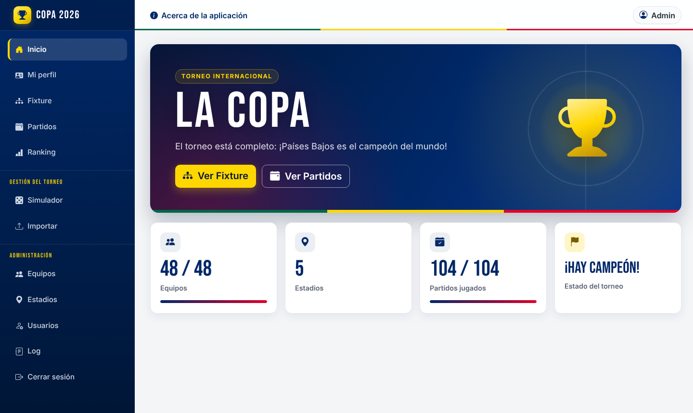
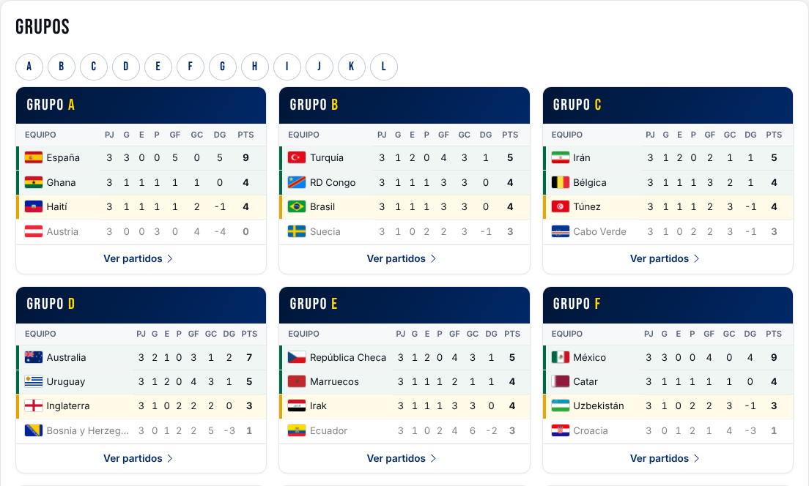
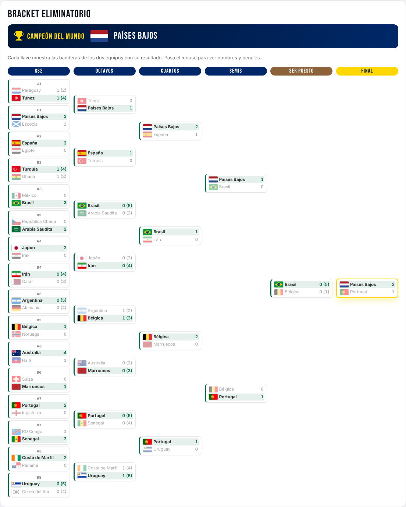

# ⚽ WorldCupPlanner

> A web application to plan and run a **48-team World Cup** — group stage, knockouts, live standings, match simulation, notifications and audit — built with **.NET 8** and a clean, fully-tested layered architecture.


WorldCupPlanner manages an entire tournament of 48 teams (12 groups of 4): users and roles,
teams with flags, stadiums, groups, matches and incidents, the full fixture (group stage →
Round of 32 → Final), a dynamic **Elo** ranking, interchangeable simulation engines,
journalist notifications, CSV/XLSX export and a global audit log.

The design keeps a strict separation of concerns: **business logic lives in the domain, services
orchestrate use cases, and the UI only presents.**

> Built as a university project (team of 3) for *Diseño de Aplicaciones 1* at Universidad ORT del
> Uruguay, following **Test-Driven Development** and **Gitflow**.

---

## ✨ Engineering highlights

- **969 automated tests · 97% line coverage** on the business layers (Domain / Services / DataAccess, excluding generated EF migrations).
- **Clean layered architecture** with enforced dependency direction — the domain depends on nothing.
- **TDD** throughout (red → green → refactor), with focused, incremental commits.
- **CI/CD with GitHub Actions**: build + tests on every push and pull request, plus automated release packaging.
- **Deterministic** ordering and simulation via configurable seeds — every seeded operation is audited (ISO-8601 timestamp + actor).

## 🧩 Features

- Tournament setup: 48 teams, confederation quotas (UEFA 16, CONMEBOL 7, CONCACAF 7, CAF 9, AFC 8, OFC 1).
- Group fixture (12 groups × 6 matches) with stadium rotation, plus the full knockout bracket (Round of 32 → Final).
- Dynamic **Elo** ranking updated as results are entered.
- **Interchangeable match simulation engines** (Strategy pattern).
- Users and roles (Admin / Editor / Journalist) and journalist notifications.
- CSV / XLSX export and a global audit log.

## 🛠️ Tech stack

| Area | Technology |
|---|---|
| Language | C# / .NET 8 |
| UI | Blazor Server |
| Data | Entity Framework Core (Code-First), Azure SQL Edge on Docker, TPH inheritance |
| Testing | MSTest + test doubles (EF InMemory provider; SQLite in-memory for FK behavior) |
| Export | CsvHelper, ClosedXML |
| Tooling | Git & Gitflow, GitHub Actions, Docker |

## 🏗️ Architecture

```
UI  ──▶  Services  ──▶  Domain
              │
              ▼
          DataAccess  ──▶  Domain
```

`Domain` has no dependencies. Single solution: `WorldCupPlanner.sln`, with projects under `src/` and tests under `tests/`.

| Layer | Project | Responsibility |
|---|---|---|
| Domain | `WorldCupPlanner.Domain` | Entities, invariants, enums and business exceptions |
| Services | `WorldCupPlanner.Services` | Use cases, orchestration, DTOs, auditing and simulation engines |
| Data | `WorldCupPlanner.DataAccess` | `AppDbContext`, EF repositories, configurations, migrations |
| UI | `WorldCupPlanner.UI` | Blazor Server — presentation only |
| Seeder | `WorldCupPlanner.DataSeeder` | Console app that resets the database and loads a full demo tournament |
| Tests | `WorldCupPlanner.*.Tests` | One MSTest suite per layer |

See [docs/architecture.md](docs/architecture.md) for the domain model, key mechanisms and external dependencies.

## 🚀 Getting started

**Prerequisites:** [.NET 8 SDK](https://dotnet.microsoft.com/download) and [Docker](https://www.docker.com/).

```bash
# 1. Start the database (Azure SQL Edge, runs natively on ARM64 too)
cp .env.example .env
docker compose up -d sqlserver

# 2. Run the app — it applies migrations and creates the default users on startup
dotnet run --project src/WorldCupPlanner.UI

# 3. (Optional) Load a full demo: 48 teams with flags, 5 stadiums, simulated group stage
dotnet run --project src/WorldCupPlanner.DataSeeder
```

Then open the URL shown in the console. The connection string lives in
`src/WorldCupPlanner.UI/appsettings.json` and can be overridden with the
`ConnectionStrings__Default` environment variable.

**Default accounts** (the demo seeder also creates `admin1@copa.com` / `Admin@123`)

| Role | Email | Password |
|---|---|---|
| Admin | admin@copa.com | Admin@123 |
| Editor | editor@copa.com | Editor@123 |
| Journalist | periodista@copa.com | Periodista@123 |

## 🧪 Running the tests

The tests need no database: they use the EF Core InMemory provider and SQLite in-memory.

```bash
dotnet test
```

Or per layer:

```bash
dotnet test tests/WorldCupPlanner.Domain.Tests
dotnet test tests/WorldCupPlanner.Services.Tests
dotnet test tests/WorldCupPlanner.DataAccess.Tests
```

## 📸 Screenshots



| Group stage | Knockout bracket |
|---|---|
|  |  |

## 📁 Project structure

```
├── src/
│   ├── WorldCupPlanner.Domain/            # Entities, business rules and invariants
│   ├── WorldCupPlanner.Services/          # Use cases, DTOs, auditing, simulation engines
│   ├── WorldCupPlanner.DataAccess/        # EF Core DbContext, repositories, migrations
│   ├── WorldCupPlanner.UI/                # Blazor Server presentation layer
│   └── WorldCupPlanner.DataSeeder/        # Demo data loader
├── tests/
│   ├── WorldCupPlanner.Domain.Tests/      # Unit tests — domain
│   ├── WorldCupPlanner.Services.Tests/    # Unit tests — services
│   └── WorldCupPlanner.DataAccess.Tests/  # Integration tests — data access
├── db/                                    # SQL seed scripts and database backups used by the release
├── docs/                                  # Architecture notes and screenshots
├── samples/                               # Sample CSV with the 48 teams (for the Import page)
├── scripts/                               # Release packaging and Windows start/seed scripts
├── .github/                               # CI/CD workflows and AI agent skills
└── WorldCupPlanner.sln
```

## 👥 Authors

Developed by a team of 3 for *Diseño de Aplicaciones 1*, Universidad ORT del Uruguay (2026).

- Manuel García Conde Neira — [manu10.garciaconde@gmail.com](mailto:manu10.garciaconde@gmail.com) · [@manuelgcn](https://github.com/manuelgcn)
- Joaquín Costa — [@CostaJoacoORT](https://github.com/CostaJoacoORT)
- Tomás Dotta — [@Toto829](https://github.com/Toto829)

## 📄 License

Released under the [MIT License](LICENSE). Flag images from [ashleedawg/flags](https://github.com/ashleedawg/flags).
