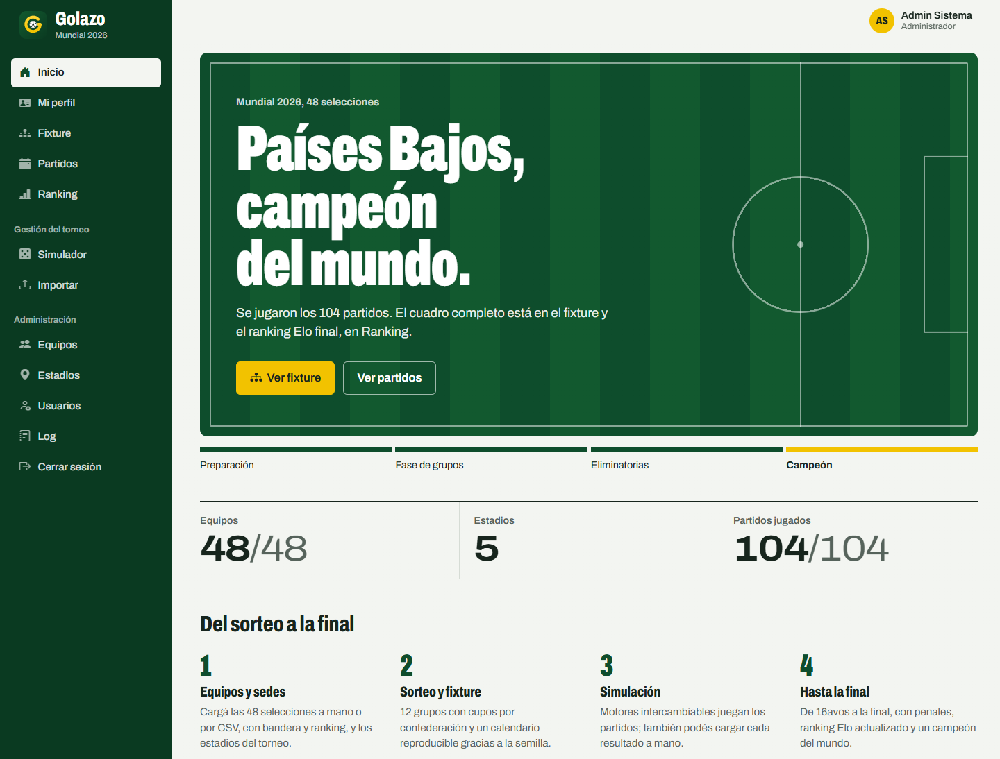

# Golazo

[](https://github.com/manuelgcn/worldcup-planner/actions/workflows/dotnet-tests.yml)

Golazo plans and runs a 48-team World Cup: team and stadium management, the group draw,
the group-stage fixture, the knockout bracket from the round of 32 to the final, an Elo
ranking and match simulation. It is a Blazor Server application on .NET 8 with EF Core.

The codebase, solution and namespaces are named `WorldCupPlanner`; Golazo is the name of the UI.

University project for *Diseño de Aplicaciones 1*, Universidad ORT Uruguay (2026).



## Features

- Teams with confederation, FIFA ranking and flag, entered by hand or imported from CSV
  (a 48-team sample is in `samples/`).
- Stadiums, and a group draw into 12 groups of 4 that respects confederation quotas.
- Group-stage fixture with dates, kick-off times and stadium rotation.
- Standings per group and the full knockout bracket, including penalties and the third-place match.
- Two interchangeable simulation engines (probabilistic and pure random); results can also be entered by hand.
- Elo ranking recalculated after every result.
- Roles: Admin, Editor and Journalist. Journalists are notified of match results.
- CSV and XLSX export of the fixture and of the audit log, which records every change with its author and time.

## Tournament rules

- **Quotas:** UEFA 16, CAF 9, AFC 8, CONMEBOL 7, CONCACAF 7, OFC 1. A group holds at most two
  UEFA teams and at most one team from any other confederation.
- **Group fixture:** six matches per group over three matchdays (1–4 and 2–3, then 1–3 and 2–4,
  then 1–2 and 3–4). The last matchday of a group is played at the same day and time.
- **Standings:** points, then goal difference, then goals scored, then a seeded draw.
- **Round of 32:** the 12 group winners, the 12 runners-up and the 8 best third-placed teams,
  avoiding same-group pairings when possible.
- **Determinism:** every shuffle is a Fisher–Yates with a configurable seed, so the same seeds
  always produce the same tournament. Each seeded operation is written to the audit log.
- **Editing:** only the date, stadium and result of a match can change. Group matches lock once
  the knockout stage exists; a knockout match locks once the next round is built from it, and
  it cannot end in a draw.

## Getting started

Requirements: [.NET 8 SDK](https://dotnet.microsoft.com/download) and [Docker](https://www.docker.com/).

```bash
cp .env.example .env
docker compose up -d sqlserver
dotnet run --project src/WorldCupPlanner.UI
```

The database is Azure SQL Edge, which also runs on ARM64. On startup the app applies pending
migrations and creates the tournament settings and three default users. Open the URL printed
in the console.

To load a demo tournament (48 teams with flags, 5 stadiums, 6 extra users and a simulated
group stage), run the seeder. It resets the database first.

```bash
dotnet run --project src/WorldCupPlanner.DataSeeder
```

### Accounts

| Role | Email | Password | Created by |
|---|---|---|---|
| Admin | admin@copa.com | Admin@123 | App startup |
| Editor | editor@copa.com | Editor@123 | App startup |
| Journalist | periodista@copa.com | Periodista@123 | App startup |
| Admin | admin1@copa.com | Admin@123 | Demo seeder |
| Editor | editor1@copa.com | Editor@123 | Demo seeder |
| Journalist | periodista1@copa.com | Prensa@123 | Demo seeder |

### Configuration

Settings live in `src/WorldCupPlanner.UI/appsettings.json`:

- `ConnectionStrings:Default`: the database. It can be overridden with the
  `ConnectionStrings__Default` environment variable.
- `TournamentSettings`: start date, maximum matches per day, days between matchdays and the
  four seeds (`FixtureSeed`, `CrossingsSeed`, `SimulationSeed`, `CompletionSeed`). They are
  only read when the database has no settings yet.
- `Flags:Directory`: the folder with the flag images, relative to the UI project.

## Tests

```bash
dotnet test
```

The suites need no database: unit tests use the EF Core InMemory provider, and tests that
need real foreign keys use SQLite in memory. One suite per layer:

```bash
dotnet test tests/WorldCupPlanner.Domain.Tests
dotnet test tests/WorldCupPlanner.Services.Tests
dotnet test tests/WorldCupPlanner.DataAccess.Tests
```

CI runs build, tests and a coverage report on every push and pull request to `main` and `develop`.

## Architecture

```
UI ──▶ Services ──▶ Domain
          │
          ▼
      DataAccess ──▶ Domain
```

| Project | Responsibility |
|---|---|
| `WorldCupPlanner.Domain` | Entities, enums, invariants and domain exceptions. No dependencies. |
| `WorldCupPlanner.Services` | Use cases, orchestration, DTOs, auditing and simulation engines. |
| `WorldCupPlanner.DataAccess` | `AppDbContext`, repositories, EF configurations and migrations. TPH for `Match` and `MatchIncident`. |
| `WorldCupPlanner.UI` | Blazor Server pages. Presentation only. |
| `WorldCupPlanner.DataSeeder` | Console app that resets the database and loads the demo tournament. |

[docs/architecture.md](docs/architecture.md) covers the domain model, the main mechanisms and the external dependencies.

Main libraries: EF Core 8 (SQL Server provider), CsvHelper for CSV and ClosedXML for XLSX.

## Repository layout

```
src/        application projects
tests/      one MSTest project per layer
docs/       architecture notes and screenshots
samples/    sample CSV with the 48 teams
db/         SQL seed scripts and database backups used by the release package
scripts/    release packaging and the Windows start/seed scripts
```

## Release package

Pushing a `v*` tag builds a self-contained Windows x64 package that only needs Docker.
See [scripts/release/README.md](scripts/release/README.md) for how to start it and load the demo.

## Contributing

The project uses Gitflow (`feature/*` branches from `develop`) and TDD, with one commit per
RED, GREEN and REFACTOR step. Conventions for code and for AI coding agents are in [AGENTS.md](AGENTS.md).

## Authors

- Manuel García Conde Neira ([@manuelgcn](https://github.com/manuelgcn), manu10.garciaconde@gmail.com)
- Joaquín Costa ([@CostaJoacoORT](https://github.com/CostaJoacoORT))
- Tomás Dotta ([@Toto829](https://github.com/Toto829))

## License

[MIT](LICENSE). Flag images come from [ashleedawg/flags](https://github.com/ashleedawg/flags).
