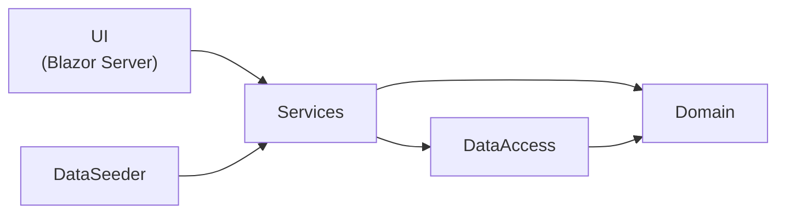
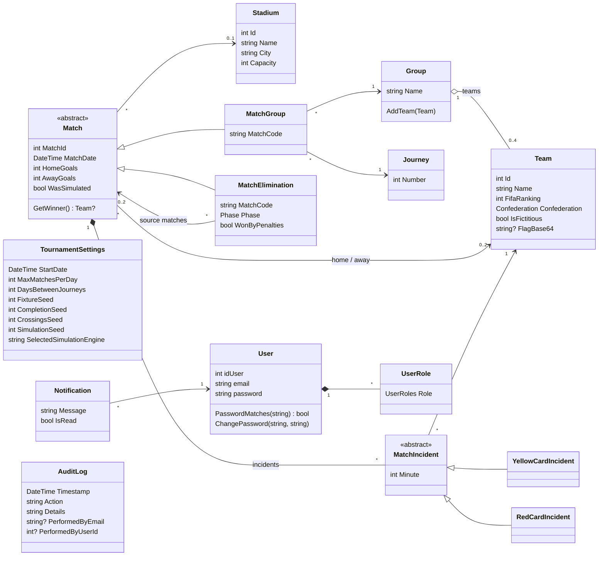

# Architecture

## Layers

- **Domain** holds the entities and their invariants. It has no dependencies.
- **Services** implement the use cases: fixture generation, standings, knockout bracket,
  simulation, ranking, tournament statistics and team profiles (`TournamentStatsService`,
  `TeamProfileService`), import/export, notifications and auditing.
- **DataAccess** maps the domain with EF Core (`IEntityTypeConfiguration<T>` per entity,
  TPH for `Match` and `MatchIncident`) and exposes repositories.
- **UI** presents data and calls services. It also owns what belongs to the web host: the
  session (`SessionState`), the security headers and the `/health` check.
- **Tests**: one MSTest project per layer. `WorldCupPlanner.UI.Tests` covers the `.cs` classes
  of the UI project, not the Razor components.

## Domain model

`MatchElimination` points to the two matches whose winners it receives, so the bracket is a
chain from the Round of 32 to the final. `AuditLog.PerformedByUserId` is a plain column, not a
relation to `User`, so the log survives a deleted user.

## Key mechanisms

- **Deterministic draws.** Every random decision uses `new Random(seed)`: Fisher–Yates for
  shuffles (ranking ties, pots, knockout pairings) and the same seeded generator for
  fictitious teams and simulated scores. Seeds are stored in `TournamentSettings`. The same seeds always produce the same tournament, and every seeded
  operation is written to the audit log.
- **Interchangeable simulation engines (Strategy).** `IMatchSimulationEngine` has two
  implementations, `ProbabilisticSimulationEngine` (weighted by ranking) and
  `PureRandomSimulationEngine`. `SimulationEngineRegistry` resolves the engine selected in
  `TournamentSettings`.
- **Elo ranking.** `EloRankingCalculator` updates each team's ranking when a result is
  recorded; `RankingService` applies and reverts the deltas when a result is edited. The
  calculator's `Forecast` gives the percentages shown next to unplayed matches
  (`MatchForecast.razor`); the simulation engines do not use it.
- **Persistence.** Each repository works on a short-lived `AppDbContext` from
  `IDbContextFactory` and saves each operation immediately. A use case that touches
  several repositories is not one transaction.
- **Errors.** Domain exceptions (`MatchException`, `SettingsException`, …) protect
  invariants; service exceptions (`MatchServicesException`, …) report use-case failures.
  The UI shows the message of a WorldCupPlanner exception and, through `UserFacingError`,
  replaces any other with a generic one that is logged.
- **Session and authorization.** `SessionState` (one per circuit) keeps the user id, email, a
  session id, a digest of the stored password hash and an 8-hour expiry in
  `ProtectedSessionStorage`, so a password change ends the account's other sessions. `Routes` restores it,
  `MainLayout` revalidates it on every navigation, and every handler that changes or exports
  data reads the user's roles again first (`StillHasAnyRoleAsync`). Logging out adds the
  session id to `RevokedSessions`, a singleton kept in memory. Authorization lives in the UI:
  apart from the exports, the services do not check the caller's role.
- **Auditing.** Mutations are logged through `AuditLogService` with a UTC timestamp, the
  actor's email and the user id that email resolves to.
- **Web host.** A middleware placed after the exception handler adds the security headers and
  the Content-Security-Policy of `SecurityHeaders` to every response. `GET /health`
  (`DatabaseHealthCheck`) answers whether the database can be reached; the root `Dockerfile`
  uses it as the health check of the container image, which runs as a non-root user.

## External dependencies

| Package | Version | License | Used for |
|---|---:|---|---|
| Microsoft.EntityFrameworkCore (SqlServer, InMemory, Sqlite) | 8.0 | MIT | Persistence; InMemory and SQLite providers in tests |
| [CsvHelper](https://www.nuget.org/packages/CsvHelper) | 33.1.0 | MS-PL / Apache-2.0 | CSV export with invariant culture and proper escaping; parsing of the team import |
| [ClosedXML](https://www.nuget.org/packages/ClosedXML) | 0.105.0 | MIT | XLSX export without Excel installed (chosen over EPPlus for its license) |
| MSTest, Moq, coverlet | — | MIT / BSD-3 | Testing and coverage |

The `.ics` calendar of the fixture is written by `FixtureCalendarWriter` without a library.

Flag images come from [ashleedawg/flags](https://github.com/ashleedawg/flags) (free to use).
