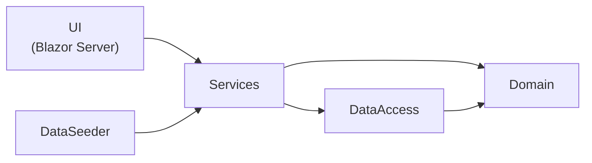
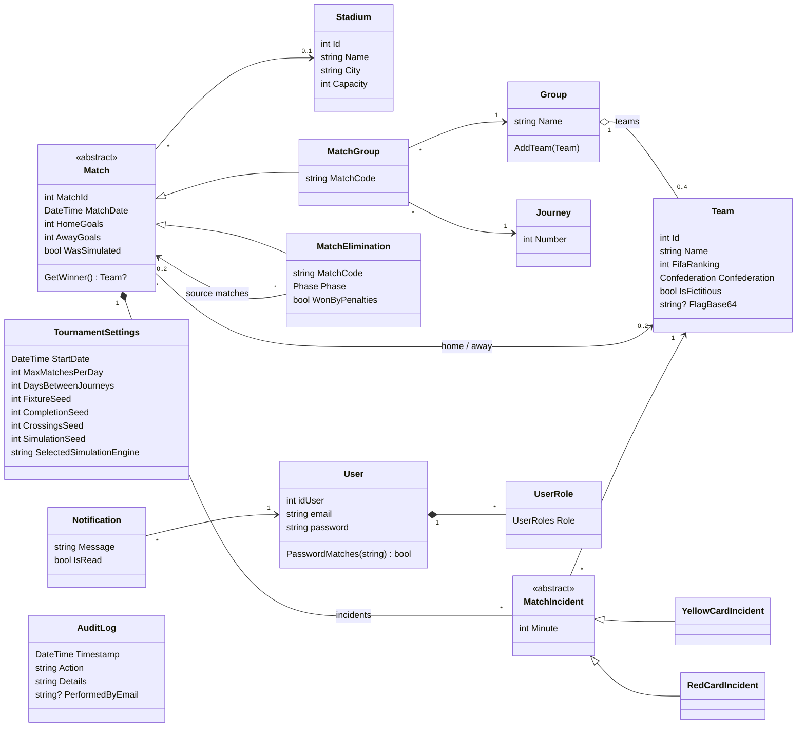

# Architecture

## Layers

- **Domain** holds the entities and their invariants. It has no dependencies.
- **Services** implement the use cases: fixture generation, standings, knockout bracket,
  simulation, ranking, import/export, notifications and auditing.
- **DataAccess** maps the domain with EF Core (`IEntityTypeConfiguration<T>` per entity,
  TPH for `Match` and `MatchIncident`) and exposes repositories plus `IUnitOfWork`.
- **UI** only presents data and calls services.

## Domain model

`MatchElimination` points to the two matches whose winners it receives, so the bracket is a
chain from the Round of 32 to the final.

## Key mechanisms

- **Deterministic draws.** Every random decision uses `new Random(seed)`: Fisher–Yates for
  shuffles (ranking ties, pots, knockout pairings) and the same seeded generator for
  fictitious teams and simulated scores. Seeds are stored in `TournamentSettings`. The same seeds always produce the same tournament, and every seeded
  operation is written to the audit log.
- **Interchangeable simulation engines (Strategy).** `IMatchSimulationEngine` has two
  implementations, `ProbabilisticSimulationEngine` (weighted by ranking) and
  `PureRandomSimulationEngine`. `SimulationEngineRegistry` resolves the engine selected in
  `TournamentSettings`.
- **Elo ranking.** `EloRankingCalculator` updates each team's ranking when a result is
  recorded; `RankingService` applies and reverts the deltas when a result is edited.
- **Persistence.** Each repository works on a short-lived `AppDbContext` from
  `IDbContextFactory`, and each operation is saved immediately through `IUnitOfWork`.
- **Errors.** Domain exceptions (`MatchException`, `SettingsException`, …) protect
  invariants; service exceptions (`MatchServicesException`, …) report use-case failures.
  The UI catches service exceptions and shows their message.

## External dependencies

| Package | Version | License | Used for |
|---|---:|---|---|
| Microsoft.EntityFrameworkCore (SqlServer, InMemory, Sqlite) | 8.0 | MIT | Persistence; InMemory and SQLite providers in tests |
| [CsvHelper](https://www.nuget.org/packages/CsvHelper) | 33.1.0 | MS-PL / Apache-2.0 | CSV export with invariant culture and proper escaping |
| [ClosedXML](https://www.nuget.org/packages/ClosedXML) | 0.105.0 | MIT | XLSX export without Excel installed (chosen over EPPlus for its license) |
| MSTest, Moq, coverlet | — | MIT / BSD-3 | Testing and coverage |

Flag images come from [ashleedawg/flags](https://github.com/ashleedawg/flags) (free to use).
